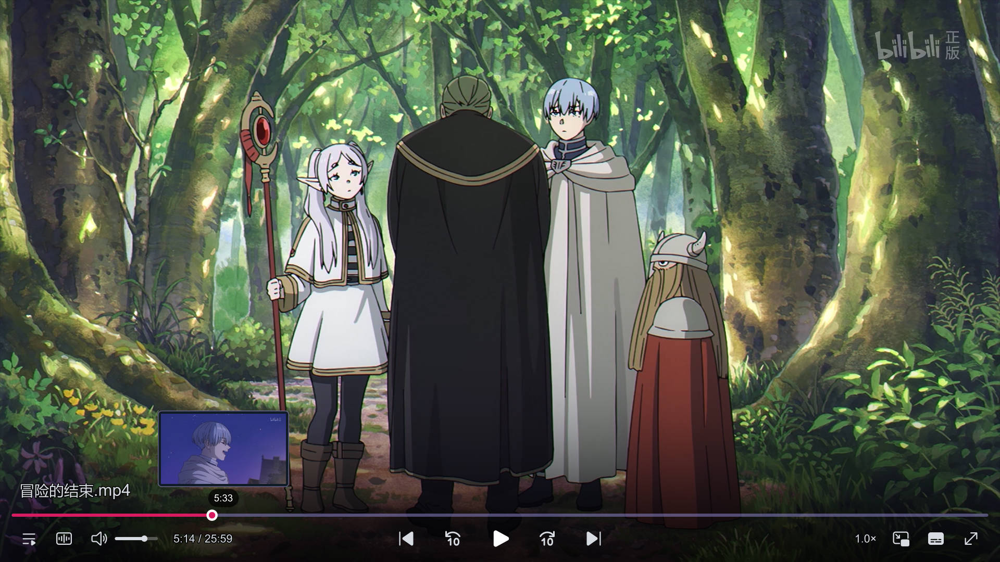

# 一套开箱即用的 MPV 播放器配置, 多种 UI 主题皮肤, 常用插件, 插帧超分等功能, 支持 Windows / macOS / Linux。

> [!TIP]
>
> - The configuration file of the mpv player supports Windows, macOS, Linux, with a consistent context menu feature across all platforms, **multiple menu styles available**
> - mpv 配置文件支持 Windows、macOS、Linux，全平台带有一致的右键菜单功能，**多种菜单样式可选**

  
  
  
  

### 🌏 中文 | [English](https://github.com/akFace/mpv.config/blob/main/README_en.md)

## 使用教程

- [查看详细使用教程](https://mpvConfig.github.io/docs/install.html)
- To check out docs, visit [Installation Guide](https://mpvConfig.github.io/docs/en)

- 下载最新版

  

## 主页

- 🎉 主页网站：[https://mpvconfig.github.io](https://mpvConfig.github.io/)
- 📔 文档主页：[https://mpvconfig.github.io/docs](https://mpvconfig.github.io/docs/)

## 主要功能

- 主题皮肤`modernz`、`uosc`、`ModernGlass`，漂亮的现代化 UI 无边框设计
- 使用原生 mpv 播放器，配置/播放器分离，无需担心播放器无法更新到最新版
- 集成进度条缩略图预览
- 集成在线中文字幕搜索，全网弹幕在线加载
- 集成 Anime4K 超分画质，实时提升画质
- 支持多种视频着色器滤镜 ⇢ [shaders 滤镜说明指南](https://mpvConfig.github.io/docs/shaders.html)
- 支持插帧模式功能 ⇢ [实时插帧/补帧功能说明](https://mpvconfig.github.io/docs/Interpolation.html)
- 视频滤镜/Anime4K/FSRCNNX/CuNNy/ArtCNN 等，可右键菜单按需加载
- 支持 360°VR 全景视频
- 可视化调节 eq 均衡器、声道切换、自动 HDR、解码切换、调色等常用功能
- 实时切换主题配色
- 自动跳过片头片尾
- Windows、macOS、Linux 全平台一致的强大右键菜单功能
- 轻量级，超简单，只需简单几步骤即可完成享用

## 主题预览截图

### 主题皮肤 modernz

### 主题皮肤 uosc

### 主题皮肤 modern_glass

### 功能强大的右键菜单

> [!IMPORTANT]
>
> **Multiple menu styles available**  
> **多种菜单样式可选**  
> 切换主题配色方法：播放器内右键 > 工具 > 主题 选择对应的名称即可

🍭 更多特性： [https://mpvconfig.github.io](https://mpvConfig.github.io/)

## 下载最新版本

## Open-source project

See also:

- [equalizer-gui](https://github.com/akFace/equalizer-gui)
- [mpv-menu-plugin-next](https://github.com/mpvConfig/mpv-menu-plugin-next)
- [switch-opts](./src/common/scripts/switch-opts.lua)
- [interp_switch](./src/common/scripts/interp_switch.lua)
- [skip-intro](./src/common/scripts/skip-intro.lua)
- [merge-input](./src/common/scripts/merge-input.lua)
- [play-with-mpv](https://github.com/akFace/play-with-mpv)
- [scheme-handler-cross](https://github.com/akFace/scheme-handler-cross)

---

Thanks to the following open-source projects for making this possible:

- [mpv](https://github.com/mpv-player/mpv)
- [thumbfast](https://github.com/po5/thumbfast)
- [celebi](https://github.com/po5/celebi)
- [uosc](https://github.com/tomasklaen/uosc)
- [ModernZ](https://github.com/Samillion/ModernZ)
- [ModernGlass](https://github.com/Demetter/ModernGlass)
- [mpv-sub-assrt](https://github.com/dyphire/mpv-sub-assrt)
- [uosc_danmaku](https://github.com/Tony15246/uosc_danmaku)
- [Anime4K](https://github.com/bloc97/Anime4K)
- [CuNNy](https://github.com/funnyplanter/CuNNy)
- [ArtCNN](https://github.com/Artoriuz/ArtCNN)
- [mpv360](https://github.com/kasper93/mpv360)
- [recent-menu](https://github.com/natural-harmonia-gropius/recent-menu)
- [awesome-mpv](https://github.com/stax76/awesome-mpv)
- [dyphire/mpv-config](https://github.com/dyphire/mpv-config)
- [mpv_PlayKit](https://github.com/hooke007/mpv_PlayKit)
- [mpv guide](https://hooke007.github.io/official_man/index.html)
