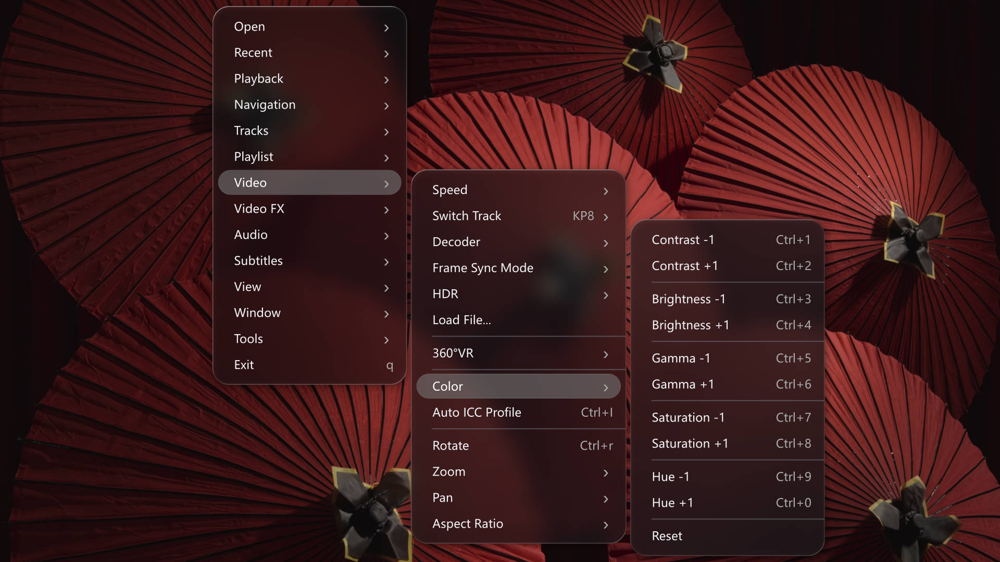
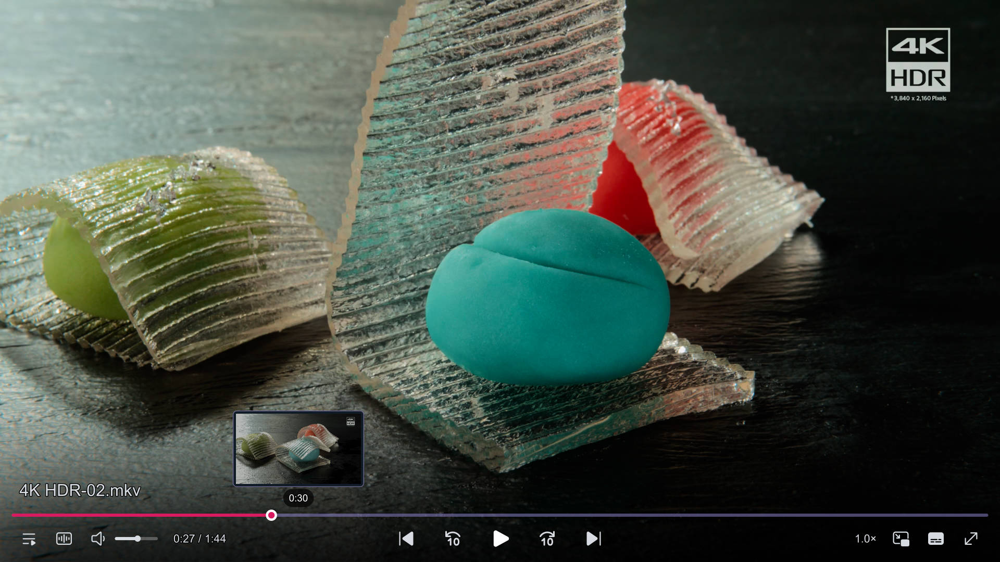

# The configuration file of the mpv player with modern themes and supports Windows, macOS, Linux

  
  
  
  

> The configuration file of the mpv player supports Windows, macOS, Linux, with a consistent context menu feature across all platforms.

#### 🌏 [中文](https://github.com/akFace/mpv.config/blob/main/README.md) | English

- Note: This document was translated by `AI-translated` and may contain some inaccuracies.

## Installation

- 🎯 To check out docs, visit [Installation Guide](https://mpvConfig.github.io/docs/en/install.html)

- Download the latest version

  

## Home Pages

- 🎉 Official website: [https://mpvconfig.github.io](https://mpvConfig.github.io/)
- 📔 Documentation: [https://mpvconfig.github.io/docs](https://mpvconfig.github.io/docs/en)

## Feature

- **Modern, Borderless UI** — Beautiful themes including `ModernZ`, `uosc`, and `ModernGlass`.
- **Native mpv Player** — Player and configuration are kept separate, so you can update mpv independently.
- **Timeline Thumbnail Previews** — Preview video frames directly on the seekbar.
- **Online Subtitles & Danmaku** — Built-in online Chinese subtitle search and danmaku loading from multiple sources.
- **Anime4K Upscaling** — Enhance video quality in real time with Anime4K.
- **Multiple Video Shaders** — Supports a wide range of video shaders and filters. ⇢ [View the Shader Guide](https://mpvConfig.github.io/docs/en/shaders.html).
- **Frame Interpolation** — Enjoy smoother playback with multiple interpolation modes. ⇢ [Frame Interpolation Guide](https://mpvconfig.github.io/docs/en/Interpolation.html)
- **On-Demand Video Filters** — Load Anime4K, FSRCNNX, CuNNy, ArtCNN, and other filters directly from the right-click menu.
- **360° VR Support** — Supports 360° VR panoramic videos.
- **Visual Audio & Video Controls** — Easily adjust the EQ, switch audio channels and decoding methods, enable automatic HDR, and fine-tune colors.
- **Live Theme Customization** — Switch theme color schemes on the fly.
- **Automatic Intro & Outro Skipping** — Skip video intros and outros automatically.
- **Cross-Platform Menus** — Consistent, feature-rich right-click menus on Windows, macOS, and Linux.
- **Lightweight & Easy to Set Up** — Get started in just a few simple steps.

## Preview

> [!TIP]
>
> You can switch the theme color in the player: Right click, Tools > Theme > Select Theme

**modern_glass** ⇣⇣

**modernz** ⇣⇣

**uosc** ⇣⇣

